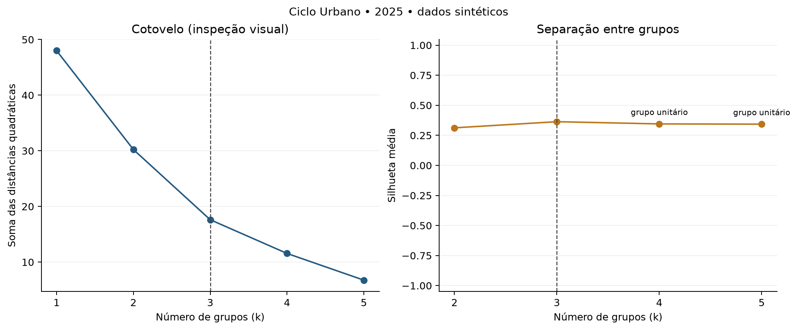
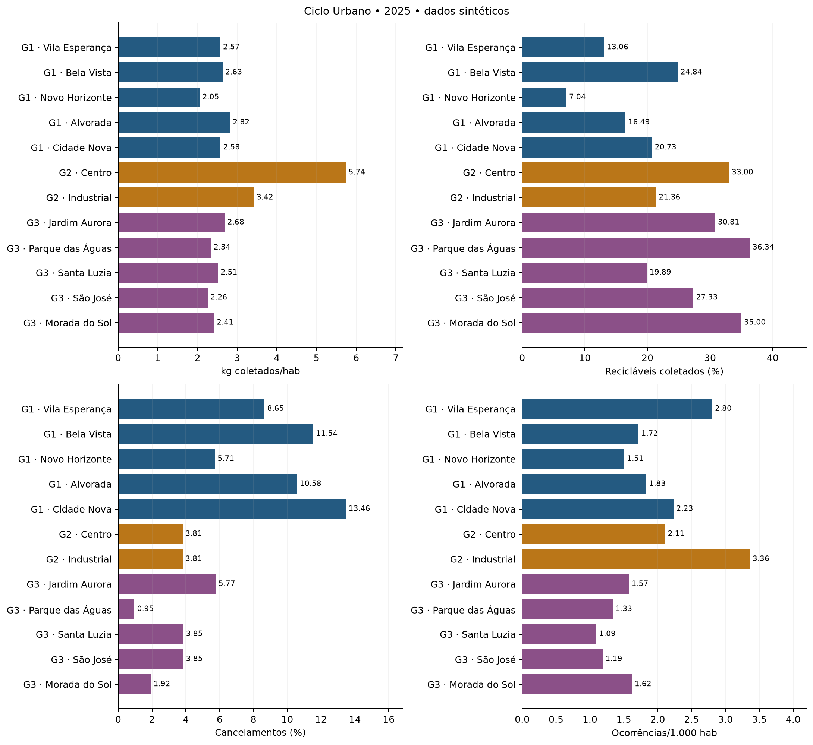
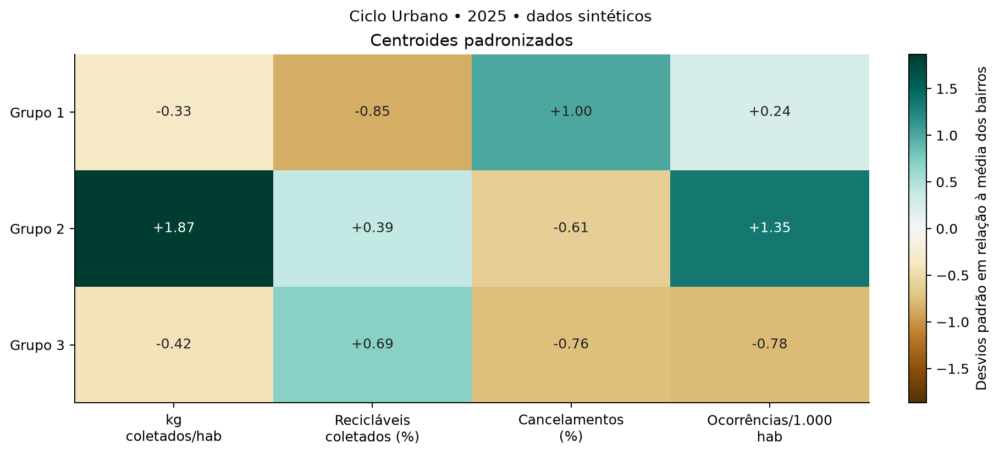
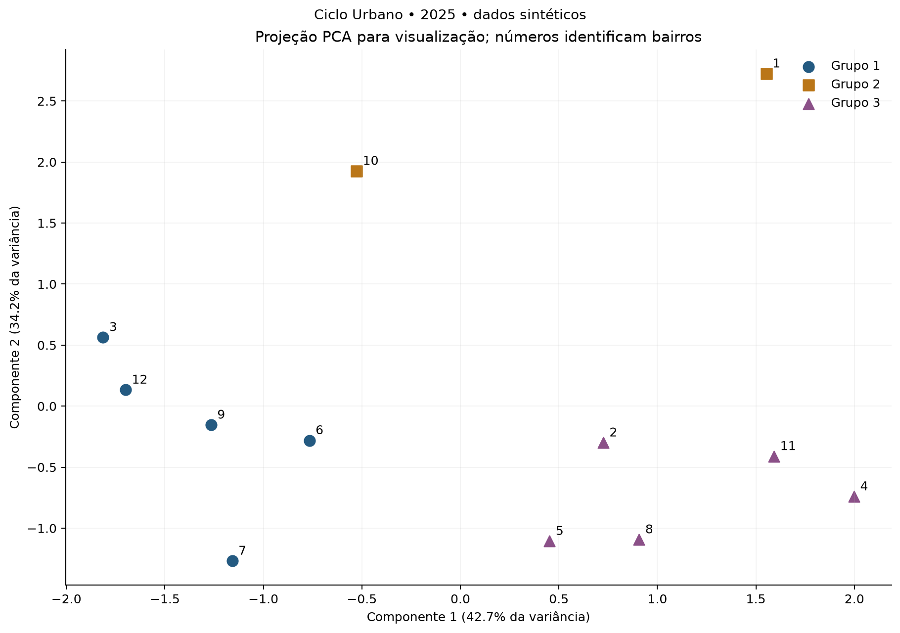
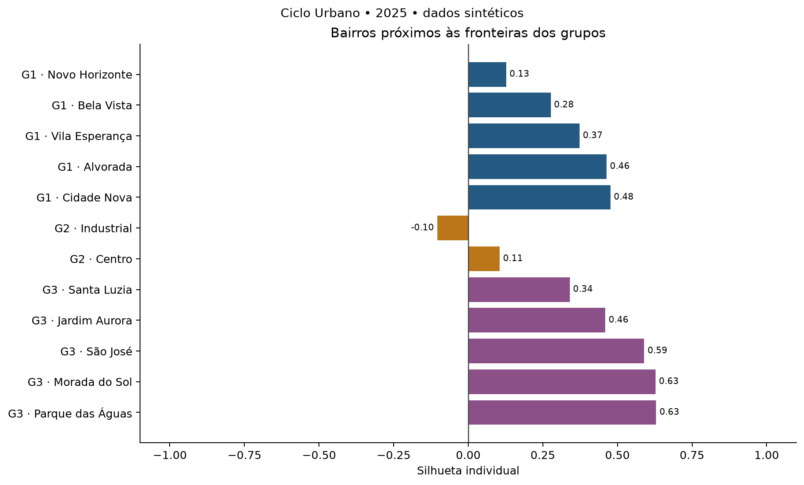

# Ciclo Urbano — mineração exploratória com K-means

**Dados sintéticos de 2025.** Este resultado descreve a simulação do projeto e seus padrões deliberados.
Fonte: SELECT no DW do PostgreSQL, em transação somente leitura. População analisada: 12 bairros, uma observação por bairro/ano.

## Problema e método

Quais bairros apresentam perfis semelhantes de coleta, participação de recicláveis,
regularidade das viagens e demanda registrada pelo cidadão? O objetivo é apoiar a
Secretaria na investigação de prioridades para coleta seletiva e regularidade do serviço.

K-means é um método não supervisionado: escolhe k centros, atribui cada bairro ao centro
mais próximo por distância euclidiana e recalcula os centros como médias. Repete o processo
até convergir, minimizando a soma das distâncias quadráticas dentro dos grupos.
Não prevê o futuro nem demonstra causas. Cada bairro tem o mesmo peso no ajuste.

## Preparação e definições

Os três fatos foram agregados separadamente antes de se reunir uma linha por bairro.
A população foi obtida uma vez por bairro, sem somar suas repetições em dim_local.
Ocorrências são contadas pela data de abertura, inclusive as ainda não resolvidas.
Canceladas integram o denominador das viagens. Não foram usadas as views arredondadas.
Nenhum bairro foi excluído e nenhum valor ausente foi imputado.

| Variável | Fórmula | Limite da interpretação |
| --- | --- | --- |
| kg_coletados_hab | peso total / população | Coleta registrada, não geração total de resíduos |
| pct_reciclaveis | 100 × peso reciclável / peso total | Material coletado, não reciclagem efetiva após triagem |
| pct_canceladas | 100 × viagens canceladas / viagens | Regularidade registrada no período |
| ocorrencias_1000_hab | 1.000 × ocorrências / população | Demanda registrada, sujeita a acesso aos canais |

As variáveis ativas foram padronizadas com StandardScaler: z = (valor − média) / desvio padrão.
Isso evita que unidades diferentes dominem a distância. Não foram removidos valores extremos.
Variáveis constantes retiradas do ajuste: nenhuma.

## Escolha de k

Escolhido **k = 3**, com silhueta média **0.3637**.
Foram avaliados k=2 até min(5, n−1, perfis distintos); k=1 aparece apenas no cotovelo.
A regra automática seleciona a maior silhueta entre soluções sem grupos unitários;
em empate exato, prefere k menor. O cotovelo é apresentado para inspeção visual e não
é declarado automaticamente. Melhor k sugerido pela regra: 3.
Uma opção manual --k fica registrada no manifesto e deve ser justificada pela equipe.
Silhueta perto de 1 indica separação, perto de zero indica sobreposição; valores negativos
sugerem bairros próximos a outro grupo. Ela não mede acurácia nem valida a existência de grupos reais.

| k | inercia | silhueta | menor_grupo | elegivel |
| --- | --- | --- | --- | --- |
| 1 | 48.0000 | — | 12 | False |
| 2 | 30.2293 | 0.3127 | 6 | True |
| 3 | 17.6169 | 0.3637 | 2 | True |
| 4 | 11.5585 | 0.3453 | 1 | False |
| 5 | 6.7549 | 0.3433 | 1 | False |

## Resultados e interpretação

Os números dos grupos são identificadores, não um ranking de qualidade. Sua ordenação
usa o centroide de recicláveis quando essa variável varia; caso contrário, a primeira variável ativa.
Centroides abaixo são médias não ponderadas dos bairros, nas unidades originais.

| grupo | kg_coletados_hab | pct_reciclaveis | pct_canceladas | ocorrencias_1000_hab |
| --- | --- | --- | --- | --- |
| 1 | 2.5303 | 16.4309 | 9.9890 | 2.0184 |
| 2 | 4.5773 | 27.1812 | 3.8095 | 2.7337 |
| 3 | 2.4405 | 29.8720 | 3.2674 | 1.3619 |

### Grupo 1

Bairros: Vila Esperança, Bela Vista, Novo Horizonte, Alvorada, Cidade Nova. Médias dos bairros: 16.43% de recicláveis coletados, 9.99% de cancelamentos e 2.02 ocorrências/1.000 habitantes. Hipóteses para orientar uma ação 5W2H: investigar acesso à seletiva e qualidade da separação antes de propor expansão; investigar regularidade das viagens antes de ampliar a operação; examinar tipos de ocorrência e canais de atendimento. Comparação relativa à média não ponderada dos bairros, sem meta externa ou evidência causal.
### Grupo 2

Bairros: Centro, Industrial. Médias dos bairros: 27.18% de recicláveis coletados, 3.81% de cancelamentos e 2.73 ocorrências/1.000 habitantes. Hipóteses para orientar uma ação 5W2H: avaliar manutenção da coleta seletiva e acompanhamento da qualidade da triagem; examinar tipos de ocorrência e canais de atendimento. Comparação relativa à média não ponderada dos bairros, sem meta externa ou evidência causal.
### Grupo 3

Bairros: Jardim Aurora, Parque das Águas, Santa Luzia, São José, Morada do Sol. Médias dos bairros: 29.87% de recicláveis coletados, 3.27% de cancelamentos e 1.36 ocorrências/1.000 habitantes. Hipóteses para orientar uma ação 5W2H: avaliar manutenção da coleta seletiva e acompanhamento da qualidade da triagem. Comparação relativa à média não ponderada dos bairros, sem meta externa ou evidência causal.

### Atribuição de cada bairro

| id_bairro | bairro | regiao | grupo | kg_coletados_hab | pct_reciclaveis | pct_canceladas | ocorrencias_1000_hab | silhueta_individual |
| --- | --- | --- | --- | --- | --- | --- | --- | --- |
| 1 | Centro | CENTRO | 2 | 5.7371 | 32.9997 | 3.8095 | 2.1081 | 0.1056 |
| 2 | Jardim Aurora | NORTE | 3 | 2.6834 | 30.8074 | 5.7692 | 1.5741 | 0.4594 |
| 3 | Vila Esperança | NORTE | 1 | 2.5724 | 13.0608 | 8.6538 | 2.8044 | 0.3729 |
| 4 | Parque das Águas | SUL | 3 | 2.3367 | 36.3381 | 0.9524 | 1.3350 | 0.6298 |
| 5 | Santa Luzia | SUL | 3 | 2.5119 | 19.8912 | 3.8462 | 1.0924 | 0.3399 |
| 6 | Bela Vista | LESTE | 1 | 2.6313 | 24.8370 | 11.5385 | 1.7166 | 0.2762 |
| 7 | Novo Horizonte | LESTE | 1 | 2.0511 | 7.0402 | 5.7143 | 1.5050 | 0.1271 |
| 8 | São José | OESTE | 3 | 2.2558 | 27.3283 | 3.8462 | 1.1884 | 0.5897 |
| 9 | Alvorada | OESTE | 1 | 2.8205 | 16.4856 | 10.5769 | 1.8310 | 0.4636 |
| 10 | Industrial | SUL | 2 | 3.4175 | 21.3628 | 3.8095 | 3.3594 | -0.1038 |
| 11 | Morada do Sol | NORTE | 3 | 2.4145 | 34.9953 | 1.9231 | 1.6195 | 0.6278 |
| 12 | Cidade Nova | LESTE | 1 | 2.5759 | 20.7308 | 13.4615 | 2.2348 | 0.4766 |

A PCA comprime as variáveis para desenhar os bairros em duas dimensões; **não entra no
ajuste do K-means**. Distâncias aparentes nessa projeção podem ocultar diferenças.

## Sensibilidade e limites

Dez inicializações adicionais foram comparadas com a partição principal usando o índice
Rand ajustado (ARI). Valor 1 significa partições iguais, independentemente dos nomes dos grupos.
Também foi retirado um bairro de cada vez, refazendo a padronização e mantendo o mesmo k;
o ARI compara a partição dos bairros restantes. Estes diagnósticos não são intervalos de
confiança e não demonstram generalização para cidades reais.

ARI entre sementes: mínimo 1.0000, média 1.0000.
ARI sem um bairro: mínimo 0.7970, média 0.9831.
Resultados completos em estabilidade_sementes.csv e sensibilidade_bairros.csv.

- Dados sintéticos com padrões deliberados; não são evidência sobre uma cidade real.
- Amostra territorial pequena: agrupamentos são exploratórios e sensíveis às variáveis.
- Há bairros com silhueta negativa; revise-os antes de usar os grupos em decisões.

- K-means impõe uma partição mesmo quando os perfis formam um contínuo. A pequena amostra
  não permite conclusões inferenciais robustas. Variáveis correlacionadas podem reforçar uma dimensão.
- A agregação anual esconde sazonalidade. Os registros cobrem os pontos simulados e não
  toda a geração municipal; o indicador kg/hab não é uma estimativa dessa geração.
- O percentual de recicláveis não mede adesão individual, potencial recuperável nem o indicador ODS 11.6.1.
- Recomendações são hipóteses exploratórias, sem custo, benefício financeiro ou ganho causal estimado.
  Antes do 5W2H, confronte os grupos com rotas, turnos, rejeitos da triagem e conhecimento operacional.

## Reprodução e evidências

Semente: 42; n_init=50; max_iter=500; algoritmo Lloyd; inicialização k-means++.
base_bairros.csv preserva a entrada validada; consulta_preparacao.sql preserva a consulta de referência
(no modo CSV, sua execução na origem não é confirmada);
manifesto.json registra hashes, parâmetros, período, data UTC e versões do ambiente.
Os arquivos CSV com centroides, variáveis padronizadas, correlações e diagnósticos
permitem conferir os números sem depender dos gráficos.

## Referências do método

- [KMeans — scikit-learn](https://scikit-learn.org/stable/modules/generated/sklearn.cluster.KMeans.html)
- [StandardScaler — scikit-learn](https://scikit-learn.org/stable/modules/generated/sklearn.preprocessing.StandardScaler.html)
- [Silhueta — scikit-learn](https://scikit-learn.org/stable/modules/generated/sklearn.metrics.silhouette_score.html)
- [Índice Rand ajustado — scikit-learn](https://scikit-learn.org/stable/modules/generated/sklearn.metrics.adjusted_rand_score.html)
