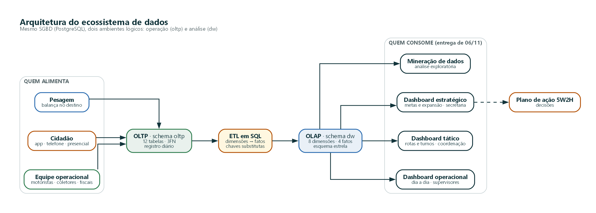
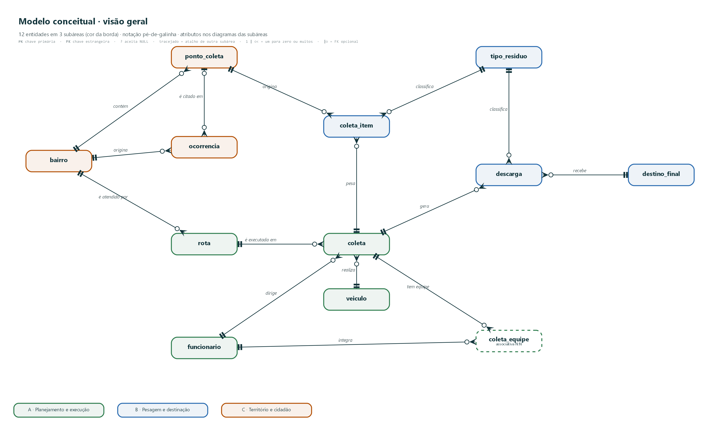
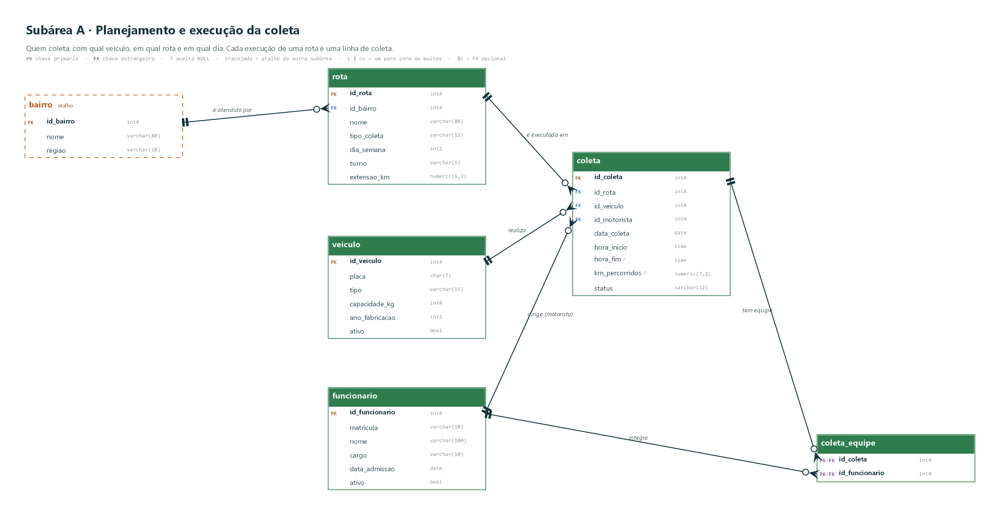
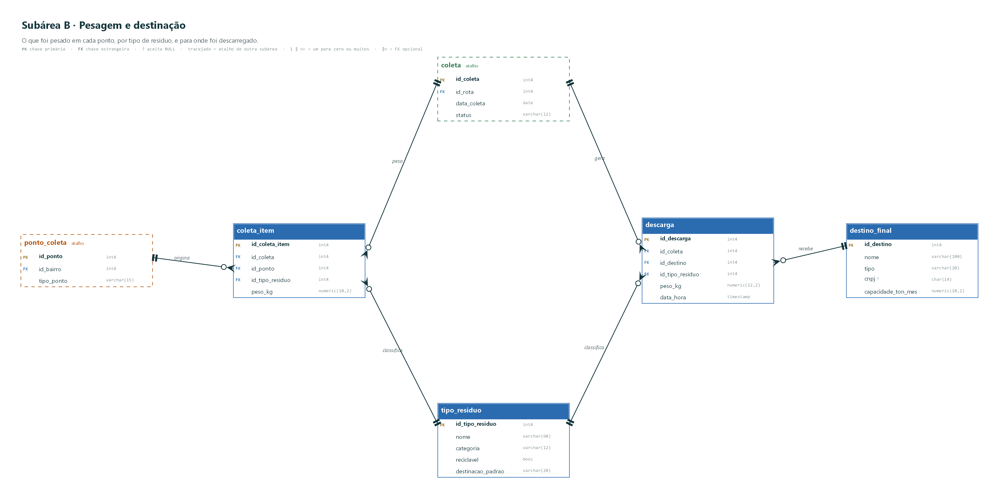
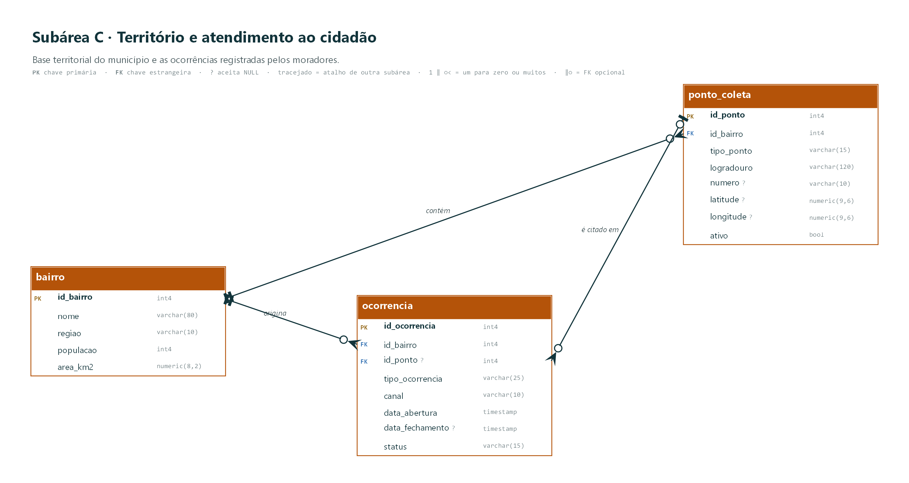
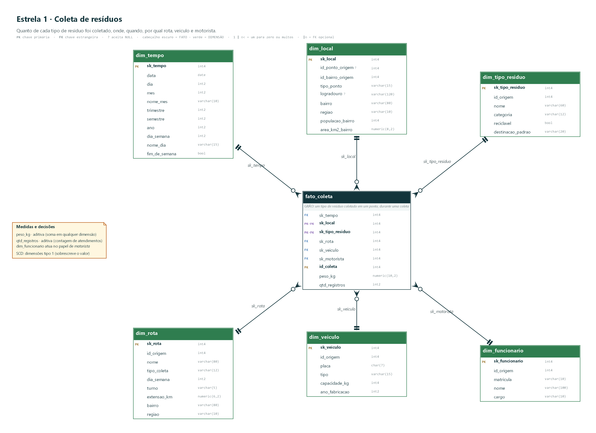
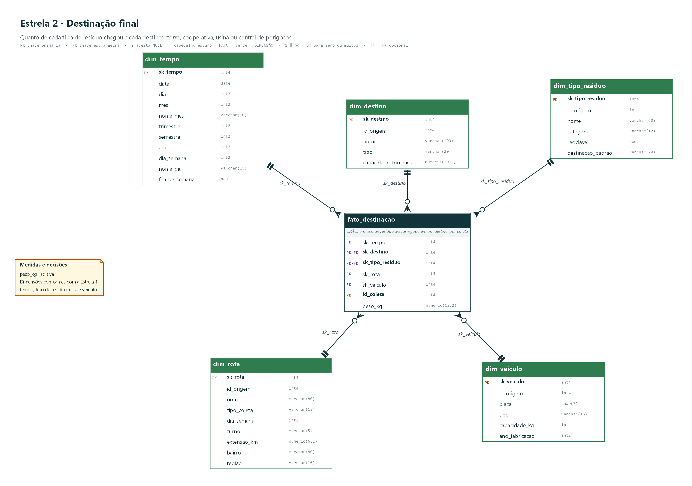
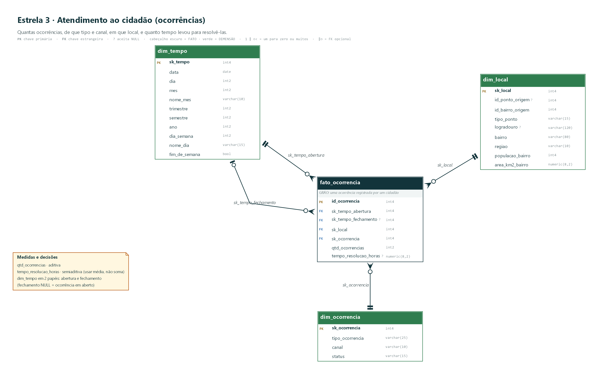
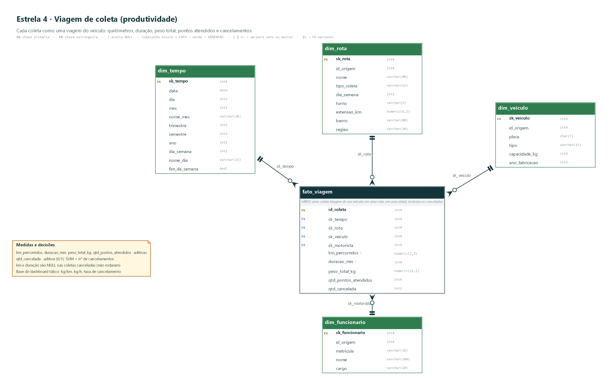

# Ciclo Urbano — Laboratório de Dados para Cidades Sustentáveis

**Gestão de resíduos sólidos urbanos e coleta seletiva · ODS 11**

| | |
|---|---|
| **Disciplina** | Tópicos Especiais em Banco de Dados — Prof. Antônio Cordeiro |
| **Entrega** | Parcial (feedback) · 19/10/2026 · itens 1 a 5 do barema |
| **Entrega final** | 06/11/2026 · itens 6 a 10 + apresentação |
| **SGBD** | PostgreSQL 17 (scripts compatíveis com 15+) |
| **Equipe** | _[preencher os nomes dos integrantes]_ |

<!-- KICKER: TÓPICOS ESPECIAIS EM BANCO DE DADOS · ENTREGA PARCIAL -->
<!-- ROTULO: Entrega parcial · 19/10/2026 -->

<!-- INICIO -->

## Resumo executivo

**O problema.** A limpeza urbana é um dos serviços mais visíveis de uma prefeitura, mas os dados que a sustentam — rotas, pesagens, destinos, reclamações — costumam viver em planilhas e papéis que não conversam entre si. O resultado é uma gestão que não sabe responder, com números, perguntas simples: *quanto foi coletado? O que foi para reciclagem? Qual rota rende menos? Quanto tempo leva para resolver uma reclamação?*

**A proposta.** Um ecossistema de dados open-source com **dois ambientes no mesmo PostgreSQL**: um banco **OLTP** (12 tabelas, 3FN) que registra a operação do dia a dia e um **Data Warehouse OLAP** (4 tabelas fato e 8 dimensões, esquema estrela) que consolida o histórico para análise. Um ETL em SQL liga os dois.

**O que já está pronto (itens 1 a 5):**

| Item | Entrega | Onde |
|---|---|---|
| 1 | Contextualização, requisitos e justificativa da ODS | Capítulos 1 e 2 |
| 2 | Modelagem OLTP — **12 entidades** (mínimo: 6) | Capítulo 3 |
| 3 | Modelagem OLAP — 4 fatos, 8 dimensões | Capítulo 4 |
| 4 | Dicionário de dados (gerado do próprio banco) | Anexo (PDF à parte) |
| 5 | Script SQL de construção + carga + ETL, **testado** | Pasta `src/sql/` |

**Em números (dados sintéticos de 2025):** 12 bairros · 343,5 mil habitantes · 240 pontos de coleta · 24 rotas · 1.252 coletas (77 canceladas) · 47.234 pesagens · **920 toneladas** coletadas · 600 ocorrências de cidadãos. O script cria, popula e confere tudo sozinho.

**O que falta (06/11):** análise exploratória com mineração de dados, 15 consultas de dashboard (5 operacionais, 5 táticas, 5 estratégicas) e o plano de ação 5W2H.

---

## 1 · O problema

*Neste capítulo: o caso da prefeitura, as dores que justificam o projeto, a base legal, o alinhamento com a ODS 11 e a pergunta que o banco de dados precisa responder.*

### 1.1 O caso: a Prefeitura de Cidade-Modelo

Para tornar o problema concreto, o projeto trabalha com uma prefeitura **fictícia**, a de **Cidade-Modelo**: 12 bairros, cerca de 343 mil habitantes e uma Secretaria de Serviços Urbanos que mantém dois serviços de coleta — a **convencional** (orgânico e rejeito) e a **seletiva** (papel, plástico, vidro e metal), esta última com pontos de entrega voluntária (**PEV**) e uma cooperativa de catadores como destino.

Hoje, cada informação vive num lugar: a escala de caminhões numa planilha, o peso na balança do aterro, as reclamações no atendimento telefônico e as rotas na cabeça do encarregado. Quando a secretária pergunta "estamos reciclando mais do que no ano passado?", ninguém consegue responder sem dias de trabalho manual — e a resposta chega tarde para decidir qualquer coisa.

### 1.2 As dores (e o que a literatura mostra)

| Dor da prefeitura | Evidência encontrada na pesquisa |
|---|---|
| **Os números oficiais divergem entre si.** Não há padronização do que é "coleta seletiva". | Estimativas do percentual de municípios com coleta seletiva variam de 14% a 60%, conforme a fonte (CEMPRE, SNIS, IBGE, Abrelpe) [1]. |
| **O dado nacional não reflete o campo.** | Estudo no semiárido baiano encontrou disparidade entre os dados do SNIS e os observados em campo [2]. |
| **Pouco se recicla.** | A coleta seletiva existia em 38,7% dos municípios (SNIS 2019), com 13,5 kg/hab/ano de recicláveis coletados [3]; a Abrelpe estima que o Brasil recicle entre 4,5% e 8,7% do que produz [4]. |

**A lição para o projeto:** o problema não é só *coletar* dados, é ter **dados locais integrados, com definições únicas** (o que é peso coletado, o que é ocorrência resolvida) e um histórico que permita comparar rotas, bairros e períodos.

### 1.3 Base legal e ODS 11

O projeto se alinha à **ODS 11 — Cidades e Comunidades Sustentáveis**, em especial à **meta 11.6** (reduzir o impacto ambiental negativo per capita das cidades, com atenção à gestão de resíduos municipais). O indicador da ONU para essa meta, o **11.6.1**, mede a *proporção de resíduos sólidos urbanos regularmente coletados e com destinação final adequada, em relação ao total gerado, por cidade* [5]. O DW do projeto fornece o **numerador** (o que foi coletado e para onde foi); o denominador (resíduo gerado) exigiria dados de geração que a prefeitura ainda não tem.

| ODS | Conexão com o projeto |
|---|---|
| **11** (principal) | Cidades limpas e inclusivas; gestão de resíduos municipais (meta 11.6); inclusão de catadores via cooperativa. |
| **12** — Consumo e produção responsáveis | Reciclagem e redução: taxa de recuperação e fluxo para a cooperativa. |
| **13** — Ação contra a mudança do clima | Desviar orgânicos do aterro (compostagem) e reduzir quilômetros rodados. |
| **3** — Saúde e bem-estar | Descarte irregular é foco de vetores; ocorrências por bairro ajudam a priorizar. |

### 1.4 Questão-foco, hipóteses e lacunas (método PBL)

No PBL, o problema vem antes do conteúdo: a equipe analisa o cenário, levanta hipóteses e identifica o que ainda precisa aprender [6].

> **Questão-foco:** *como integrar os dados da coleta de resíduos de uma prefeitura em um ecossistema OLTP + OLAP que sustente decisões operacionais, táticas e estratégicas e meça o avanço da reciclagem?*

| Hipótese | Como o projeto vai testá-la (06/11) |
|---|---|
| H1 — Há rotas com produtividade (kg/km) bem abaixo da média. | Dashboard tático sobre `fato_viagem`. |
| H2 — Cancelamentos se concentram em certos turnos. | Dashboard tático (cancelamento por turno). |
| H3 — O tempo de resolução de ocorrências varia por tipo e região. | Dashboard operacional/tático sobre `fato_ocorrencia`. |
| H4 — A taxa de recicláveis difere entre regiões e indica onde expandir a seletiva. | Dashboard estratégico + análise exploratória. |

### 1.5 Escopo: o que está dentro e o que está fora

| Dentro do escopo | Fora do escopo (decisão consciente) |
|---|---|
| Registro de coletas, pesagens, descargas e ocorrências | Roteirização automática / otimização de rotas |
| DW histórico com 4 processos de negócio | Rastreamento GPS em tempo real |
| Dashboards em SQL (consultas) e análise exploratória | Aplicativo ou interface web para o cidadão |
| Dados **sintéticos** que simulam 2025, com padrões deliberados | Integração com sistemas reais (SNIS/SINIR) |

---

## 2 · Requisitos

*Neste capítulo: o que o cliente precisa saber (perguntas de negócio), o que o sistema deve fazer e quais regras de negócio o banco de dados precisa garantir.*

### 2.1 Necessidades do cliente: perguntas de negócio

Seguindo o método PBL [7], a necessidade do cliente é descrita em **linguagem de gestão**, não de tecnologia. As 15 perguntas abaixo são o "briefing" da prefeitura: cada uma indica quem a faz e onde está a resposta no banco. Elas orientam o modelo (capítulos 3 e 4) e serão o **enunciado** das consultas dos itens 7, 8 e 9 do barema.

| ID | Pergunta do cliente | Quem pergunta | Responde com |
|---|---|---|---|
| **Operacional** | *o que está acontecendo agora* (consulta o OLTP) | | |
| O1 | Quais coletas foram canceladas e de qual rota, veículo e motorista? | Supervisão de operação | `coleta`, `rota`, `veiculo`, `funcionario` |
| O2 | Quais ocorrências estão abertas há mais de 72 horas? | Supervisão de operação | `ocorrencia`, `bairro` |
| O3 | Quais veículos mais rodaram na semana? | Coordenação de frota | `coleta`, `veiculo` |
| O4 | Qual a taxa de ocupação dos veículos (peso coletado ÷ capacidade)? | Coordenação de frota | `coleta`, `coleta_item`, `veiculo` |
| O5 | Quantas coletas cada coletor fez na semana? | Supervisão de operação | `coleta_equipe`, `funcionario`, `coleta` |
| **Tático** | *como estamos indo* (consulta o DW) | | |
| T1 | Quais rotas rendem menos quilos por quilômetro? | Coordenação de rotas | `fato_viagem`, `dim_rota` |
| T2 | Em que turno e dia da semana mais se cancelam coletas? | Coordenação de rotas | `fato_viagem`, `dim_rota`, `dim_tempo` |
| T3 | Quanto tempo leva, em média, resolver cada tipo de ocorrência em cada região? | Atendimento | `fato_ocorrencia`, `dim_ocorrencia`, `dim_local` |
| T4 | Os veículos mais antigos cancelam mais coletas? | Coordenação de frota | `fato_viagem`, `dim_veiculo` |
| T5 | Há motoristas com produtividade ou cancelamentos muito diferentes dos demais? | Coordenação de rotas | `fato_viagem`, `dim_funcionario` |
| **Estratégico** | *para onde vamos* (consulta o DW) | | |
| E1 | Como evolui a quantidade coletada, por mês e por tipo de resíduo? | Secretaria | `fato_coleta`, `dim_tempo`, `dim_tipo_residuo` |
| E2 | Qual a taxa de recicláveis por região e bairro? Onde expandir a coleta seletiva? | Secretaria | `fato_coleta`, `dim_local`, `dim_tipo_residuo` |
| E3 | Quanto do material enviado à cooperativa vira rejeito, por tipo de material? | Secretaria e cooperativa | `fato_destinacao`, `dim_destino`, `dim_tipo_residuo` |
| E4 | Qual a participação de cada destino e quanto da capacidade mensal ele usa? | Secretaria | `fato_destinacao`, `dim_destino` |
| E5 | Como evoluem as ocorrências por trimestre e região? | Secretaria | `fato_ocorrencia`, `dim_tempo`, `dim_local` |

> [!NOTE]
> **Decisão de projeto — o modelo não é maior que as perguntas.** Os 12 elementos do OLTP, os 4 fatos e as 8 dimensões respondem a pelo menos uma pergunta. Um elemento sem pergunta que o justifique seria cortado.

### 2.2 Requisitos funcionais

| ID | Requisito |
|---|---|
| RF01 | Cadastrar bairros, pontos (incl. PEV), rotas, veículos, funcionários, tipos de resíduo e destinos finais. |
| RF02 | Registrar coletas (rota, data, veículo, motorista, equipe, horários, km, status). |
| RF03 | Registrar o peso coletado por ponto e por tipo de resíduo. |
| RF04 | Registrar descargas por destino e tipo de resíduo. |
| RF05 | Registrar ocorrências do cidadão e o ciclo até a resolução. |
| RF06 | Consolidar o histórico em um DW com dimensões conformes. |
| RF07 | Permitir consultas operacionais, táticas e estratégicas sobre OLTP/DW. |

### 2.3 Requisitos não funcionais (mensuráveis)

| ID | Requisito | Como verificar |
|---|---|---|
| RNF01 | SGBD relacional open-source. | PostgreSQL 17 (compatível com 15+). |
| RNF02 | OLTP normalizado até a 3FN, com integridade referencial. | 15 chaves estrangeiras · 28 `CHECK` · 9 `UNIQUE` · 64 colunas `NOT NULL`. |
| RNF03 | OLAP em esquema estrela, com chaves substitutas. | 8 dimensões com `sk_*`; fatos só referenciam `sk_*`. |
| RNF04 | Carga completa reexecutável por um único script. | `DROP SCHEMA … CASCADE` no início; execução sem erro. |
| RNF05 | Contagens do OLTP e do DW devem coincidir. | Consulta de verificação no fim do script de construção. |
| RNF06 | Dicionário de dados mantido no catálogo do banco. | `COMMENT ON` em 100% das tabelas e colunas (0 colunas sem comentário). |
| RNF07 | Tempo de carga completa (dados + ETL) abaixo de 1 minuto em máquina comum. | Medido na execução: **≈ 4 s** no ambiente de desenvolvimento. |

### 2.4 Regras de negócio e onde o banco as garante

> [!IMPORTANT]
> **Regras de negócio** não ficam só no texto: cada uma é uma restrição do banco, para que dado inválido nem entre.

| ID | Regra | Garantia no banco |
|---|---|---|
| RN01 | Cada bairro tem no máximo uma rota convencional e uma seletiva. | `UNIQUE (id_bairro, tipo_coleta)` em `rota` |
| RN02 | Uma rota só executa uma vez por data. | `UNIQUE (id_rota, data_coleta)` em `coleta` |
| RN03 | O término de uma coleta é posterior ao início. | `CHECK ck_coleta_horas` |
| RN04 | Convencional coleta orgânico e rejeito; seletiva coleta recicláveis. | Regra aplicada na carga/aplicação (documentada) |
| RN05 | Cada tipo de resíduo tem uma destinação padrão; o rejeito da triagem dos recicláveis segue ao aterro. | `destinacao_padrao` + `CHECK` de domínio; rejeito registrado em `descarga` |
| RN06 | Ocorrência é "resolvida" se, e somente se, tem data de fechamento ≥ abertura. | `CHECK ck_ocorrencia_status` e `ck_ocorrencia_datas` |
| RN07 | Um mesmo tipo de resíduo não se repete no mesmo ponto da mesma coleta. | `UNIQUE (id_coleta, id_ponto, id_tipo_residuo)` |
| RN08 | Peso nunca é negativo. | `CHECK (peso_kg >= 0)` |

---

## 3 · Modelagem OLTP

*Neste capítulo: como o modelo foi construído em três níveis — conceitual, lógico e físico — e as decisões por trás de cada tabela.*

### 3.1 O ecossistema em uma imagem

A operação grava no **OLTP**; um **ETL** em SQL alimenta o **DW**; os dashboards e a mineração consomem o DW (e, no nível operacional, o próprio OLTP). Tudo roda no mesmo PostgreSQL, separado por *schemas*.

### 3.2 Modelo conceitual e lógico: 12 entidades em 3 subáreas

O modelo foi dividido em **três subáreas** para poder ser lido sem se perder: uma visão geral só com entidades e relacionamentos (Figura 3) e um diagrama detalhado por subárea (Figuras 4 a 6). Notação **pé-de-galinha**; as tabelas tracejadas são *atalhos* de entidades de outra subárea. O modelo está em **3FN**, com 15 chaves estrangeiras e restrições `CHECK` e `UNIQUE` que garantem as regras de negócio da seção 2.4.

| Subárea | Entidades | Pergunta que responde |
|---|---|---|
| **A · Planejamento e execução** | `rota`, `coleta`, `coleta_equipe`, `veiculo`, `funcionario` | Quem coletou, com qual veículo, em qual rota, em qual dia? |
| **B · Pesagem e destinação** | `coleta_item`, `descarga`, `tipo_residuo`, `destino_final` | O que foi pesado, de que tipo e para onde foi? |
| **C · Território e cidadão** | `bairro`, `ponto_coleta`, `ocorrencia` | Onde? E o que os moradores reportaram? |

---

## 4 · Modelagem OLAP

*Neste capítulo: como o Data Warehouse foi desenhado seguindo os quatro passos de Kimball [8], a matriz de barramento e as quatro estrelas.*

### 4.1 Os quatro passos de Kimball aplicados

| Passo | Decisão neste projeto |
|---|---|
| **1 · Processo de negócio** | Quatro: **coleta** (o que foi retirado), **viagem** (como a coleta andou), **destinação** (para onde foi) e **ocorrência** (o que o cidadão reportou). |
| **2 · Grão** | Declarado *antes* das dimensões, no nível mais atômico: pesagem por ponto e tipo (coleta); uma coleta (viagem); descarga por destino e tipo; uma ocorrência. |
| **3 · Dimensões** | Quem, o quê, onde, quando: tempo, local, tipo de resíduo, rota, veículo, funcionário (motorista), destino e ocorrência. |
| **4 · Fatos** | Só medidas numéricas no grão: peso, km, duração, pontos atendidos, cancelamentos, tempo de resolução. |

### 4.2 Matriz de barramento

Cada linha é um processo (fato); cada coluna, uma dimensão. As dimensões usadas por mais de um fato são **conformes**: têm as mesmas chaves e atributos em todas as estrelas, o que permite comparar processos diferentes (*drill-across*).

| Dimensão | `fato_coleta` | `fato_viagem` | `fato_destinacao` | `fato_ocorrencia` |
|---|:---:|:---:|:---:|:---:|
| `dim_tempo` | ✔ | ✔ | ✔ | ✔ (2 papéis) |
| `dim_local` | ✔ | | | ✔ |
| `dim_tipo_residuo` | ✔ | | ✔ | |
| `dim_rota` | ✔ | ✔ | ✔ | |
| `dim_veiculo` | ✔ | ✔ | ✔ | |
| `dim_funcionario` | ✔ (motorista) | ✔ (motorista) | | |
| `dim_destino` | | | ✔ | |
| `dim_ocorrencia` | | | | ✔ |

### 4.3 As quatro estrelas

Em cada diagrama, a tabela **fato** (cabeçalho escuro) fica no centro e as **dimensões** (verdes) ao redor. O **grão** vem escrito dentro da fato e a **aditividade** das medidas, na nota.

> [!NOTE]
> **Decisão de projeto — por que 4 fatos e não 1.** Os processos têm **grãos diferentes**. Misturá-los numa só tabela repetiria o km da viagem em cada pesagem, e somar km daria um total inflado. A `fato_viagem` guarda o km uma única vez por coleta; a `fato_coleta` guarda o peso por ponto e tipo.

### 4.4 Medidas, aditividade e hierarquias

| Fato | Medida | Aditividade | Observação |
|---|---|---|---|
| `fato_coleta` | `peso_kg` | **aditiva** | Pode ser somada por qualquer dimensão. |
| `fato_viagem` | `km_percorridos`, `duracao_min`, `peso_total_kg`, `qtd_pontos_atendidos`, `qtd_cancelada` | **aditivas** | `km` e `duracao` são NULL nas coletas canceladas (não rodaram). `SUM(qtd_cancelada)` = nº de cancelamentos. |
| `fato_destinacao` | `peso_kg` | **aditiva** | |
| `fato_ocorrencia` | `qtd_ocorrencias` | aditiva | |
| `fato_ocorrencia` | `tempo_resolucao_horas` | **semiaditiva** | Usar **média**, nunca soma; NULL = ainda em aberto. |

---

## Referências

1. Levantamento comparativo de estimativas de coleta seletiva (CEMPRE, SNIS, IBGE, Abrelpe). Repositório da UFC, repositorio.ufc.br.
2. Estudo sobre consórcio de resíduos no semiárido baiano: disparidade entre dados do SNIS e do campo. Rev. Ciências Exatas e Ambientais, UCP. seer.ucp.br.
3. Artigo com base no SNIS 2019 sobre coleta seletiva (38,7% dos municípios; 13,5 kg/hab/ano). periodicos.ufpb.br (GAIA).
4. ECYCLE. *Até 35% dos resíduos recebidos por cooperativas acabam como rejeito, aponta estudo nacional*. ecycle.com.br. (Estimativa da Abrelpe de 4,5% a 8,7% de reciclagem no Brasil, citada em estudo de coleta seletiva.)
5. UNEP / UN-Habitat. **SDG indicator 11.6.1** — proportion of municipal solid waste collected and managed in controlled facilities. sdgs.unep.org.
6. Aprendizagem Baseada em Problemas em disciplinas de banco de dados. SBC — Workshop sobre Educação em Computação. sol.sbc.org.br.
7. LINGE, N.; PARSONS, D. **Problem-based learning as an effective tool for teaching computer network design**. IEEE Transactions on Education, v. 49, n. 1, p. 5-10, fev. 2006. DOI 10.1109/TE.2005.852600. (Método de trabalho em grupo indicado no enunciado.)
8. KIMBALL, R.; ROSS, M. **The Data Warehouse Toolkit**. 3. ed. Wiley, 2013. (Processo de quatro passos, grão, matriz de barramento — conforme sínteses consultadas.)

